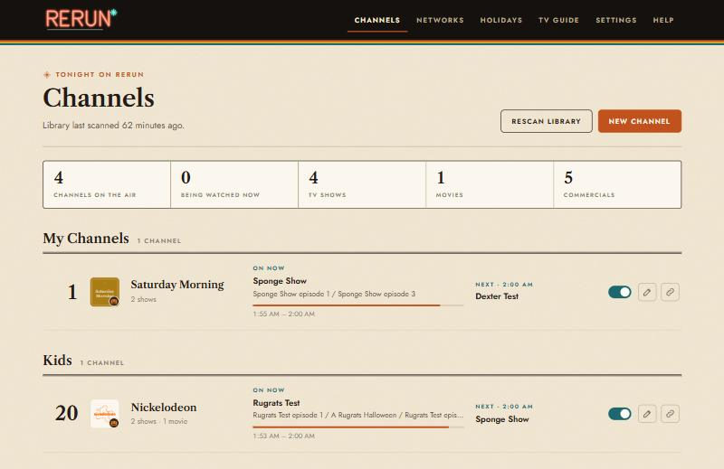

# Rerun

Live TV channels made from your own Plex library — a Nickelodeon channel, a Cartoon
Network channel, an MTV-style music video channel, a Christmas channel — with real network
logos, commercials, a TV guide, and shows that start on the hour and half hour. Plex sees
Rerun as an ordinary TV tuner.



It is built to be boring to run:

- **Comes back by itself.** It runs as a background service that starts with the computer
  and restarts itself if anything goes wrong.
- **Updates only when you say so.** Running the installer again updates it; your settings
  are backed up first, and if the new version won't start, the old one is put back.
- **Hard to break.** Only your channel settings matter; schedules, library info and caches
  rebuild themselves. A missing or broken video shows a "We'll be right back" card instead
  of killing the channel.
- **Private.** No accounts, no tracking. The only things it looks up online are which
  network a show aired on and network logos (only ID numbers are sent). It only answers
  devices on your home network and keeps your Plex sign-in on this computer.

## What you need

- Ubuntu 22.04 or newer (desktop or server) with Plex on it, or able to reach it. No Docker.
- **Plex Pass**, because Plex's Live TV feature needs it. (VLC, Jellyfin and TiviMate can
  use Rerun without Plex Pass.)
- Optional: a free [TMDB API key](https://www.themoviedb.org/settings/api) for the most
  accurate networks. A TVMaze key is **not** needed.

## Install

On the Ubuntu computer, open a terminal (Ctrl+Alt+T), paste this line and press Enter:

```bash
wget -qO- https://github.com/Groot36-yep/rerun/archive/refs/heads/main.tar.gz | tar xz -C /tmp && bash /tmp/rerun-main/install.sh
```

Answer the pop-up windows: your password, then your media folders (it suggests the ones
Plex uses). When it's done, open **Rerun TV** from your app menu, or go to
`http://YOUR-COMPUTER-IP:8410` from any device at home.

A short setup in the browser signs in to Plex, picks your libraries and lets you choose
which networks become channels.

**Updating:** run `rerun update`. Your channels and settings are kept, and if the new
version won't start, the old one is put back automatically.

## Intel Quick Sync and other graphics chips

Rerun turns your shows into live TV on the fly, so the video encoding is the heavy part.
With **Hardware encoding** on *Automatic* (the default), Rerun uses Intel Quick Sync (or an
AMD chip) for both decoding and encoding, and falls back to the processor by itself if the
chip can't do it. On Intel machines the installer also adds Intel's full media driver.

To check it's working, run `rerun check-gpu`, or look at Settings → Picture & sound, which
says "Encoding with Intel Quick Sync". Newer Intel chips that only have the low-power
encoder are handled too.

## Adding the channels to Plex

The last setup step (and the Help page) shows this with copy buttons:

1. Plex Web → **Settings → Live TV & DVR → Set Up Plex DVR**.
2. Choose **"Don't see your HDHomeRun device? Enter its network address manually"** and
   enter `YOUR-COMPUTER-IP:8410`.
3. When asked for a guide, choose **"Have an XMLTV guide on your server?"** and enter
   `http://YOUR-COMPUTER-IP:8410/xmltv.xml`.

For VLC, Jellyfin, TiviMate and Channels, use `http://YOUR-COMPUTER-IP:8410/iptv.m3u`.

## Making Plex start channels faster

Rerun hands Plex several seconds of picture the moment you tune in. Most of the remaining wait
is Plex itself, and these Plex settings help (Plex Web → **Settings**):

- **Transcoder → Use hardware acceleration when available**: on. With an Intel processor this
  lets Plex use Quick Sync too.
- **Transcoder → Transcoder temporary directory**: `/dev/shm`. Plex then writes live TV to
  memory instead of the disk.
- In the Plex app on each TV or phone, set **video quality to Original / Maximum** for your home
  network. Rerun's channels are already in a format every Plex app can play, so Plex doesn't
  have to convert them.

## Networks, logos and holidays

- **Networks** lists every network in your library. Switch one on and it becomes a channel
  with its official logo; switch it off and it's gone for good. Small sister channels
  (Nicktoons, Boomerang) share their big sister's channel until they have enough shows.
- About 80 networks have their official logo built in; others come from your TMDB key or
  Wikipedia, and anything else gets a printed-style card drawn by Rerun.
- **Holidays** covers Valentine's Day, St. Patrick's Day, Easter, the Fourth of July,
  Halloween, Thanksgiving, Christmas and New Year's. Holiday episodes are found by title,
  description and Plex collection name, kept off the air out of season, mixed into your
  channels in season, and can get a channel of their own.

## Commercials and music videos

Put them in folders inside a media folder. Sub-folders become tags each channel can use:

```
/mnt/media/commercials/80s/...
/mnt/media/commercials/nick/        ← bumpers and promos for the Nickelodeon channel
/mnt/media/music-videos/80s/Artist - Song (1985).mp4
```

Breaks go at chapter marks (where DVD and Blu-ray rips have act breaks), evenly through
the show, or only between shows, and are sized so the next show starts on the half hour.

## Everyday commands

| Command | What it does |
| --- | --- |
| `rerun status` | Is it running? Shows the web address. |
| `rerun open` | Open Rerun in your browser. |
| `rerun logs` | Recent activity. |
| `rerun backup` / `rerun restore FILE` | Save or restore your channels and settings. |
| `rerun reset-password` | Forgot the web password. |
| `rerun stop` / `rerun start` | Turn it off (stays off) or on. |
| `rerun update` | Install the newest version, or change media folders or the port. |
| `rerun check-gpu` | Check that Intel Quick Sync (or AMD) encoding works. |
| `rerun uninstall` | Remove it (keeps your settings). |

## Troubleshooting

- **A channel shows "We'll be right back".** A file couldn't be read; "Recent activity" on
  the Help page says which one.
- **Plex can't find the tuner.** Use the computer's network address, not `localhost`, and
  make sure a firewall isn't blocking port 8410 (the installer offers to allow it).
- **Video stutters.** Run `rerun check-gpu` to make sure Quick Sync is being used, or lower the
  picture size in Settings. If the graphics chip doesn't work, Rerun notices and uses the
  processor instead.

## Where things live

- `/opt/rerun` — the program. `/var/lib/rerun` — your settings (`config.json`,
  `secrets.json`) plus schedules and caches that rebuild themselves.
- The service runs as your user, can read your media, and can only write to `/var/lib/rerun`.

## Credits

The page fonts are [Libre Caslon Text](https://fonts.google.com/specimen/Libre+Caslon+Text)
and [Jost](https://fonts.google.com/specimen/Jost), both under the SIL Open Font License
(see `app/static/fonts`). Network logos come from TMDB and Wikipedia and belong to their
owners. Rerun isn't affiliated with Plex or any TV network.
