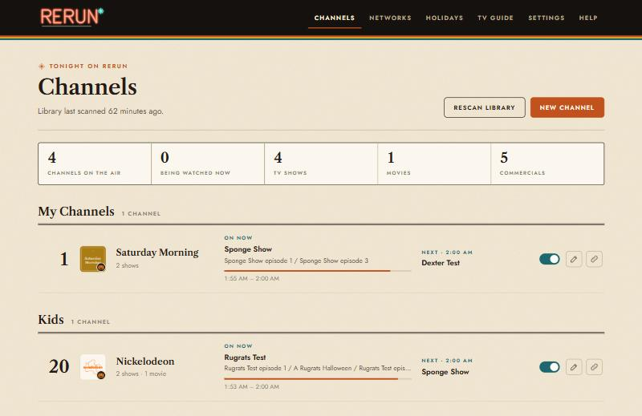

# Rerun

Live TV channels made from your own Plex library — a Nickelodeon channel, a Cartoon
Network channel, an MTV-style music video channel, a Christmas channel — with real network
logos, commercials, a TV guide, and shows that start on the hour and half hour. Plex sees
Rerun as an ordinary TV tuner.



It is built to be boring to run:

- **Comes back by itself.** It runs as a background service that starts with the computer
  and restarts itself if anything goes wrong.
- **Updates only when you say so.** Running the installer again updates it; your settings
  are backed up first, and if the new version won't start, the old one is put back.
- **Hard to break.** Only your channel settings matter; schedules, library info and caches
  rebuild themselves. A missing or broken video shows a "We'll be right back" card instead
  of killing the channel.
- **Private.** No accounts, no tracking. The only things it looks up online are which
  network a show aired on and network logos (only ID numbers are sent). It only answers
  devices on your home network and keeps your Plex sign-in on this computer.

## What you need

- Ubuntu 22.04 or newer (desktop or server) with Plex on it, or able to reach it. No Docker.
- **Plex Pass**, because Plex's Live TV feature needs it. (VLC, Jellyfin and TiviMate can
  use Rerun without Plex Pass.)
- Optional: a free [TMDB API key](https://www.themoviedb.org/settings/api) for the most
  accurate networks. A TVMaze key is **not** needed.

## Install

On the Ubuntu computer, open a terminal (Ctrl+Alt+T), paste this line and press Enter:

```bash
wget -qO- https://github.com/Groot36-yep/rerun/archive/refs/heads/main.tar.gz | tar xz -C /tmp && bash /tmp/rerun-main/install.sh
```

Answer the pop-up windows: your password, then your media folders (it suggests the ones
Plex uses). When it's done, open **Rerun TV** from your app menu, or go to
`http://YOUR-COMPUTER-IP:8410` from any device at home.

A short setup in the browser signs in to Plex, picks your libraries and lets you choose
which networks become channels.

**Updating:** run `rerun update`. Your channels and settings are kept, and if the new
version won't start, the old one is put back automatically.

## Intel Quick Sync and other graphics chips

Rerun turns your shows into live TV on the fly, so the video encoding is the heavy part.
With **Hardware encoding** on *Automatic* (the default), Rerun uses Intel Quick Sync (or an
AMD chip) for both decoding and encoding, and falls back to the processor by itself if the
chip can't do it. On Intel machines the installer also adds Intel's full media driver.

The installer also adds a current ffmpeg: [Jellyfin's build](https://github.com/jellyfin/jellyfin-ffmpeg)
(`jellyfin-ffmpeg7`, from Jellyfin's own package source). Ubuntu 22.04 only has ffmpeg 4.4, which
is slower to start channels; Jellyfin's build is current and comes with Intel's Quick Sync drivers.
If it can't be installed, Rerun uses Ubuntu's ffmpeg. To skip it:
`RERUN_SYSTEM_FFMPEG=1 bash install.sh`.

To check it's working, run `rerun check-gpu`, or look at Settings → Picture & sound, which
says "Encoding with Intel Quick Sync". Newer Intel chips that only have the low-power
encoder are handled too.

## Adding the channels to Plex

The last setup step (and the Help page) shows this with copy buttons:

1. Plex Web → **Settings → Live TV & DVR → Set Up Plex DVR**.
2. Choose **"Don't see your HDHomeRun device? Enter its network address manually"** and
   enter `YOUR-COMPUTER-IP:8410`.
3. When asked for a guide, choose **"Have an XMLTV guide on your server?"** and enter
   `http://YOUR-COMPUTER-IP:8410/xmltv.xml`.

For VLC, Jellyfin, TiviMate and Channels, use `http://YOUR-COMPUTER-IP:8410/iptv.m3u`.

## Making Plex start channels faster

Rerun hands Plex several seconds of picture the moment you tune in. Most of the remaining wait
is Plex itself, and these Plex settings help (Plex Web → **Settings**):

- **Transcoder → Use hardware acceleration when available**: on. With an Intel processor this
  lets Plex use Quick Sync too.
- **Transcoder → Transcoder temporary directory**: `/dev/shm`. Plex then writes live TV to
  memory instead of the disk.
- In the Plex app on each TV or phone, set **video quality to Original / Maximum** for your home
  network. Rerun's channels are already in a format every Plex app can play, so Plex doesn't
  have to convert them.

## Networks, logos and holidays

- **Networks** lists every network in your library. Switch one on and it becomes a channel
  with its official logo; switch it off and it's gone for good. Small sister channels
  (Nicktoons, Boomerang) share their big sister's channel until they have enough shows.
- About 80 networks have their official logo built in; others come from your TMDB key or
  Wikipedia. Anything else gets a logo drawn by Rerun in a 1960s style that suits the channel:
  bubble letters for kids, neon and light bulbs for music, a theatre marquee for movies, a
  station-ID starburst for classic TV.
- **Holidays** covers Valentine's Day, St. Patrick's Day, Easter, the Fourth of July,
  Halloween, Thanksgiving, Christmas and New Year's. Holiday episodes are found by title,
  description and Plex collection name, kept off the air out of season, mixed into your
  channels in season, and can get a channel of their own.

## Commercials and music videos

Put them in folders inside a media folder. Sub-folders become tags each channel can use:

```
/mnt/media/commercials/80s/...
/mnt/media/commercials/nick/        ← bumpers and promos for the Nickelodeon channel
/mnt/media/music-videos/80s/Artist - Song (1985).mp4
```

Breaks go at chapter marks (where DVD and Blu-ray rips have act breaks), evenly through
the show, or only between shows, and are sized so the next show starts on the half hour.

## Classic commercials, found for you

**Find more commercials** on the Commercials page finds real commercials, promos and bumpers that people taped off
TV and saved on the [Internet Archive](https://archive.org). Pick networks (Nickelodeon, Nick Jr.,
Disney Channel, Playhouse Disney, Cartoon Network, Kids' WB, Fox Kids, MTV, PBS Kids and more), eras
(70s through 2020s) and how much space to use, and Rerun:

- keeps only tapes whose titles say they're that network's commercials, promos or bumpers from
  those years, aired in the US, with no full episodes mixed in;
- downloads them into its own data folder (`/var/lib/rerun/commercials`);
- finds each commercial in a tape by the black, silent gap between ads, and keeps clips from 5
  seconds to 2 minutes long, so they play one by one without the tape being cut up;
- files them by network and era: the Nickelodeon channel plays Nick ads, and channels named for a
  decade ("90s Cartoons", "2000s Cartoons") play that decade's ads from every network.

Tick **Halloween** or **Christmas** to fetch holiday tapes too. Holiday commercials only air in their
season, and tapes recorded in October or December are favoured in that month.

**Quality comes from the files, not the titles.** Before downloading anything, Rerun reads each
tape's file list and ranks the tapes by their real picture size, bitrate and frame rate, so the
sharpest tapes are fetched first. It downloads each tape as it was uploaded rather than the archive's
re-compressed copy. After downloading it checks whether the video was blown up from a smaller
picture (a 240-line capture saved as 480p or 1080p is common): such tapes are labelled with their
real sharpness and ranked accordingly, and the quality you pick (360p or 480p) applies to the real
picture. Most of these are VHS recordings, so expect standard definition.

**Whole broadcasts too.** Many uploads are a show or movie recorded *with its original commercials*.
Rerun reads these straight from the archive, finds the commercial breaks (runs of ad-length
pieces between long stretches of show), and saves only the breaks, so a 6-hour tape costs a few
hundred megabytes. Tapes that say their commercials were cut out are skipped.

**Cleaner clips.** Pieces are lined up with the lengths ads were sold in (10, 15, 30, 60
seconds...): a commercial cut in two by a fade to black is put back together. When the uploader
listed the ads in the description, the clips are named after them ("Pizza Hut (How Deep Is Your
Love)").

**No repeats.** The same commercial often turns up on several tapes. Rerun recognises copies by
tiny fingerprints of their pictures and keeps only the best-looking one on the air.

**Long files are split for you.** A break lasts a few minutes, so a commercials file longer than
2½ minutes (a compilation from YouTube, say) is split into its single commercials the first time
it's scanned, the same way as downloaded tapes. One that can't be split is left out rather than
filling a break.

The same page shows every commercial Rerun can play: how many are on the air, a bar showing how
many are HD, good, watchable or low quality, and filters by network, decade, season, quality and
source. Each commercial has a picture and its exact quality (size, frame rate, bitrate, and whether it
was blown up from a smaller picture). Click one to watch it, and **Remove** any you don't want on the
air (nothing is deleted; "Removed ones" puts them back). **Find more commercials** opens the finder;
while it runs, its progress shows at the top of the page.

**Breaks that match the show.** Each break picks commercials that fit what's on: a Disney episode
gets Disney commercials (Halloween Disney ones in October), a 2004 episode gets 2000s ads, and a
show from a network you have no ads for gets plain ads rather than another network's.

**Bumpers and idents in the right place.** Bumpers and idents ("You're watching Disney Channel",
Nick's splats, "We'll be right back") are told apart from commercials: short clips from bumper tapes,
clips named like one, and anything in a `bumpers`, `idents` or `intros` folder. They play where the
network put them: the show's own network ident right before it starts, and one of its bumpers leading
into each break. On a mixed channel like *2000s Cartoons*, a Disney show opens with a Disney ident and
the Nick show after it with a Nick one; a show from a network you have no bumpers for gets none rather
than someone else's. Holiday bumpers come first in season and stay on the shelf the rest of the year.
To add your own, put them in a commercials folder under the network's name and a `bumpers` folder, e.g.
`commercials/disney/bumpers/` (network folder names: `nick`, `nickjr`, `disney`, `playhouse`,
`toondisney`, `cn`, `adultswim`, `boomerang`, `kidswb`, `foxkids`, `abcfamily`, `mtv`, `pbskids`).

These are other people's recordings of broadcast TV, downloaded for watching at home. Delete them
any time from the same place.

## Add from YouTube

**Add from YouTube** on the Commercials page searches YouTube or opens links you paste (single videos or
whole playlists). Tick the videos you want and say what they are:

- **Commercials, promos & bumpers.** Rerun works out the network, decade and holiday from each title
  ("Nickelodeon Commercials (05/26/2003)" goes to Nickelodeon, 2000s), or you choose them. A
  compilation is split into single commercials, a short clip is kept as one, and a whole episode
  recorded "with commercials" keeps only its breaks, exactly like tapes from the Internet Archive:
  the same picture-quality checks, duplicate checks and network-logo check apply.
- **An "Up next" template.** Saved under `bugs/custom/upnext/` with the show or network name you give,
  ready to play.

**Search YouTube automatically.** In **Find more commercials** (and on the 25 Days page), "Search YouTube
too" makes the finder also search YouTube for each network and decade you pick ("Nickelodeon
commercials 2003", "ABC Family commercials December 2008"…), judge the results by the same rules as
archive tapes (right network and years, US airings, no fan-made imitations), and download the best
within your space limit, shared with the archive. Copies of an ad you already have are skipped unless
they're sharper.

Downloads run in the background, shown at the top of the Commercials page. Rerun uses
[yt-dlp](https://github.com/yt-dlp/yt-dlp), which the installer keeps up to date (`rerun update` gets the
newest; YouTube changes often and old copies stop working). Some YouTube videos need a JavaScript
runtime: if [deno](https://deno.com) or Node.js is installed on the server, Rerun uses it. Downloads are
for watching at home.

## Holiday TV and movie channels

On the **Holidays** page each holiday can have a **TV channel** (holiday episodes only), a **movie
channel** (holiday movies only), or one mixed channel, e.g. *Halloween TV* and *Halloween Movies*.

## Boomerang and other classic channels

Some channels ran other networks' shows: Plex lists *Scooby-Doo* under CBS and *The Jetsons* under ABC,
not Boomerang. **Networks → Classic channels → Boomerang** builds the channel from Boomerang's real
2000–2009 lineup (from Wikipedia's list of programs Boomerang aired): about 120 shows, marked as staples
(aired year after year), regulars, or occasional. It shows which ones you have and which you still need
(copy the list, or open it as text), adds the channel, and finds Boomerang's bumpers, idents and
commercials on the Internet Archive. On the Boomerang channel every show opens with a Boomerang ident
and goes into its breaks with a Boomerang bumper, whatever network the show first aired on.

**Nick Jr.** and **Disney Junior** work the same way. Plex files *Blue's Clues* under Nickelodeon and
*Bear in the Big Blue House* under Disney Channel, so each has its own lineup: Nick Jr. from the
preschool mornings on Nickelodeon to the Nick Jr. channel (1994–2012, about 30 shows), and Disney
Junior including Playhouse Disney before it (1997–2018, about 40 shows), from Wikipedia's lists of
their programs.

## The look of real TV

- **Network logo in the corner.** A see-through logo sits in the corner of the picture during shows (not
  during commercials), inside the picture even when an old 4:3 show has bars at the sides. A network's
  own channel shows its own logo; a mixed channel like *2000s Cartoons* shows each show's original
  network. It's the logo the network had the year the episode first aired: the orange splat on a 2003
  *SpongeBob*, the checkerboard on a 1998 *Dexter's Laboratory*, Playhouse Disney's on a 2004 *JoJo's
  Circus* (Nickelodeon, Cartoon Network, Disney Channel, Boomerang, Playhouse Disney, Toon Disney,
  Nicktoons, Fox Kids and Kids' WB, from Wikipedia and Wikimedia Commons). To use your own, put a
  picture in Rerun's data folder under `bugs/custom/`, named after the network or its tag
  (`Nickelodeon.png`, `boomerang.png`), with years for the ones it had then (`Nickelodeon 1984-2009.png`,
  `cn 1998.png`).
- **Bumpers from the right year.** Bumpers and idents are matched to the episode's year as well as its
  network: a 2003 episode gets bumpers from around 2003, going by the year in the bumper's (or its
  tape's) name. Commercials lean the same way.
- **"Up next" banner.** Near the end of a show, before its last break, a banner says what's on next,
  in the style of the network the show is on: Nickelodeon's 2000s orange plaid bar along the bottom
  with the next show's poster popping up out of it, Cartoon Network's checkerboard, Disney Channel's
  blue glow, Boomerang's retro starburst, and red and gold with snowflakes on the 25 Days channel. Each
  comes on its own way (rising up, sliding in, fading in). Other networks get a plain banner in the
  colour of their logo. These are drawn in the spirit of each channel's look, not its actual artwork.
- **Your own "Up next" templates.** For the real thing, put a green-screen template (a picture or a
  video, like the "Nick Up Next" templates people share) in Rerun's data folder under
  `bugs/custom/upnext/`, named after a show (`SpongeBob SquarePants.png`, used whenever it's up next) or a
  network (`Nickelodeon.mp4`). The green is see-through (templates on black work too). When the green is
  a window rather than the whole background, the show squeezes into it while the template plays, the
  way networks squeezed the end credits for a promo. Videos play for their own length, pictures for 10
  seconds. To have Rerun write the next show's name on a template, add a file with the same name ending
  in `.json`, e.g. `{"title": {"x": 0.42, "y": 0.9, "size": 0.05, "color": "#ffffff"}}` (positions as
  fractions of the picture).

- **"More after the break".** In the last seconds before a break in the middle of a show, a strip in the
  network's style says the show continues after the break, or names the next episode when two share a
  half hour.
- **Promos.** Early in a show, a lower third promotes something later on the same channel: a movie
  first, then whatever's on at 8, as in "Tonight at 8: Jimmy Neutron: Boy Genius".

Each can be switched off in Settings → Picture & sound. The program log (see below) shows when each
appears.

## Checking it without waiting

- **Preview.** The ▶ button next to a channel (or **Preview** on its page) opens its program log: the
  next four hours item by item, with every show, ident, bumper, commercial and card, and where the logo
  and "Up next" appear. **Watch this break** makes a short video of the end of the show (with its "Up
  next"), the bumper, the commercials and the ident into the next show, drawn by the same code as live
  TV. It takes a few seconds to make and doesn't touch what's on the air.
- **Test channel in Plex.** **Make a test channel** in the same window turns channel 999, *Rerun Test*,
  into a sped-up copy of that channel: real shows a minute or so at a time with every break, so the
  ident, logo, "Up next", bumpers and commercials come round every few minutes in Plex itself. Rerun
  asks Plex to reload its guide; if the channel doesn't appear, refresh the guide (or scan for channels)
  in Plex's Live TV & DVR settings. Remove it from the same window when you're done.

## Christmas, the 2000s way

The **Christmas Channel** runs a day like 2000s cable did: cartoons and specials in the morning,
sitcom Christmas episodes in the afternoon, family specials at dinnertime, a big holiday movie at 8,
late-night movies and overnight classics. 2000s titles come up more often, 2000s holiday commercials
go first, and the guide counts down the days to Christmas. On Christmas Eve at 8pm it switches to
**24 Hours of A Christmas Story** until 8pm Christmas Day, if you have the movie. Switch a channel back
to a plain shuffle on the Holidays page.

Rerun also knows the Christmas movies whose titles don't say so (Elf, The Polar Express, Home Alone,
Jingle All the Way...), and the Holidays page lists 78 2000s Christmas essentials (movies, specials
and episodes), with which ones you have and which you still need.

## ABC Family's 25 Days of Christmas

The **25 Days** page recreates ABC Family's 25 Days of Christmas as it aired in **December 2008** or
**December 2009**, from ABC Family's published schedules: every movie and special at the same date and
clock time (Eastern times, played at the same clock times where you are). It:

- checks your Plex library for every title and lists what you **have** and what you **still need**
  (with how often each one airs), matching by name and year so that, for example, the 1979 *Jack
  Frost* special and the 1998 movie are told apart. Copy the list or open it as text;
- adds a channel that plays the schedule from December 1 to 25. Tune in late and the movie is
  already part-way through. Between listings it runs your ABC Family shows (or Christmas episodes),
  like ABC Family's daytime. Titles you don't have can be filled with other Christmas titles from
  your library, or shown as a card saying what to get;
- finds that December's real commercials on the Internet Archive: commercial breaks people taped
  and whole broadcasts recorded with their commercials, then the years either side. When Rerun has a
  recording of the very broadcast (such as ABC Family's Narnia premiere on December 12, 2008), its
  breaks play at the same moments in the movie, in their original order.

## Everyday commands

| Command | What it does |
| --- | --- |
| `rerun status` | Is it running? Shows the web address. |
| `rerun open` | Open Rerun in your browser. |
| `rerun logs` | Recent activity. |
| `rerun backup` / `rerun restore FILE` | Save or restore your channels and settings. |
| `rerun reset-password` | Forgot the web password. |
| `rerun stop` / `rerun start` | Turn it off (stays off) or on. |
| `rerun report` | A diagnostic report to paste when asking for help (also on the Help page). |
| `rerun update` | Install the newest version, or change media folders or the port. |
| `rerun check-gpu` | Check that Intel Quick Sync (or AMD) encoding works. |
| `rerun uninstall` | Remove it (keeps your settings). |

## Troubleshooting

For anything odd, watch a channel in Plex for a minute, then run `rerun report` (or use **Copy
report** on the Help page). It shows what Plex asked Rerun for, how fast channels started, how
hard the computer is working and any recent problems, with no passwords in it.

- **A blue card shows up ("We'll be right back", or just the channel's name).** A file couldn't be
  found or played; "Recent activity" on the Help page says which one. A missing or broken
  commercial is replaced by another of the same length, so a card means none fitted. A show whose
  logo or banner can't be drawn plays without them rather than turning into a card. Removing a
  network's commercials replans the breaks without them.
- **Channel logos don't show in Plex.** Plex only reads channel logos when a DVR is set up, so
  after changing anything about logos, delete the Rerun DVR in Plex (Settings → Live TV & DVR)
  and set it up again, then fully restart the Plex app. Plex apps on a secure connection
  (Apple TV, phones, app.plex.tv) only load logos from public https addresses, so the guide Plex
  reads points at two free image services: network logos come from TMDB through wsrv.nl, and
  other channels get a lettered card from placehold.co. They only see which logo or channel name
  is being drawn. To keep everything at home instead (logos then only show in Plex Web opened by
  its IP address): Settings → Guide → Pictures in Plex → Straight from Rerun.
- **Plex can't find the tuner.** Use the computer's network address, not `localhost`, and
  make sure a firewall isn't blocking port 8410 (the installer offers to allow it).
- **Video stutters.** Run `rerun check-gpu` to make sure Quick Sync is being used, or lower the
  picture size in Settings. If the graphics chip doesn't work, Rerun notices and uses the
  processor instead.

## Where things live

- `/opt/rerun` — the program. `/var/lib/rerun` — your settings (`config.json`,
  `secrets.json`) plus schedules and caches that rebuild themselves.
- The service runs as your user, can read your media, and can only write to `/var/lib/rerun`.

## Credits

The fonts are [Libre Caslon Text](https://fonts.google.com/specimen/Libre+Caslon+Text),
[Jost](https://fonts.google.com/specimen/Jost) and [Shrikhand](https://fonts.google.com/specimen/Shrikhand),
all under the SIL Open Font License (see `app/static/fonts` and `app/fonts`). Network logos come from TMDB and Wikipedia and belong to their
owners. Rerun isn't affiliated with Plex or any TV network.
